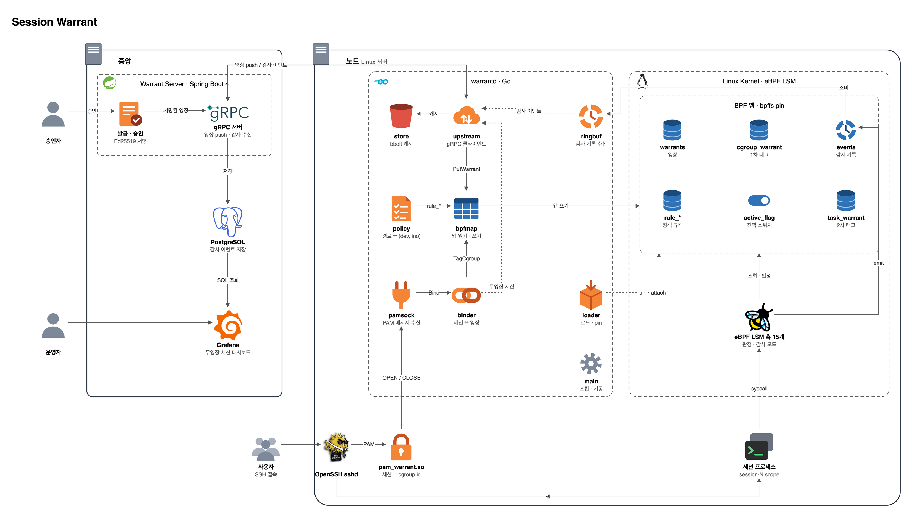

# Session Warrant

[English](README.md) | **한국어**

**범위와 기한이 정해진 SSH 접근을, 셸이 아니라 커널이 집행한다.**

## 목차

- [프로젝트 개요](#프로젝트-개요)
- [목적](#목적)
- [기술 상세](#기술-상세)
- [기술 스택](#기술-스택)
- [요구사항](#요구사항)
- [설치방법](#설치방법)
- [문서](#문서)

---

## 프로젝트 개요

Session Warrant 는 모든 SSH 세션에 **영장(warrant)** 을 붙인다. 누가, 왜, 언제까지,
무엇을 할 수 있는지가 담긴다. 영장은 리눅스 커널 안의 **eBPF LSM 훅**이 집행하므로
`sudo` · `su` · `nohup` · 백그라운드 작업을 거쳐도 세션을 따라가고, 세션이 열려 있는
동안에도 기한이 되면 바로 만료된다.

게이트웨이형 SSH 접근제어(Teleport · StrongDM · Boundary 등)는 문을 통제한다.
Session Warrant 는 **문을 통과한 다음**을 통제한다. 경쟁이 아니라 보완이다.

### 핵심 특징

- **커널이 집행한다.** DAC 권한 검사 뒤에 LSM 훅이 판정하므로 uid 0 도 영장 밖으로 나가지 못한다.
- **표식이 세션을 따라간다.** 세션 cgroup 과 fork 체인 두 겹에 붙어 `sudo` · `su` · `nohup` 을 거쳐도 떨어지지 않는다.
- **만료가 열린 세션 안에서 발효된다.** 타이머 없이 매 판정마다 시각을 비교한다. 취소는 한 바이트다.
- **판정 중에 유저 공간으로 올라가지 않는다.** 중앙 서버나 노드 에이전트가 죽어도 이미 발급된 영장의 집행은 계속된다.
- **영장 없는 접속을 잡아낸다.** 게이트웨이를 우회한 로그인이 사람 · 키 · 출발지와 함께 기록되고 경보로 올라온다.
- **감사 → 드라이런 → 강제로 나눠 도입한다.** 감사는 재부팅 없이 시작하고, 쌓인 데이터를 근거로 강제를 켠다.
- **싸다.** 읽기는 통제하지 않고 쓰기 비트 한 줄로 거르므로, 쓰기 포화 조건에서도 `file_open` 비용이 1% 미만이다.

---

## 목적

게이트웨이가 구조적으로 못 하는 세 가지를 호스트에서 한다.

| 게이트웨이의 한계 | 호스트에서 |
|---|---|
| **우회된다.** `authorized_keys` 에 직접 넣은 키 하나, 비상 경로 하나면 게이트웨이를 거치지 않는다 | 영장 없는 세션을 호스트가 잡아낸다 |
| **세션 안이 안 보인다.** 셸을 넘긴 뒤의 `scp` · 포트 포워딩 · 비대화형 명령은 프로토콜 층 밖이다 | `exec` · `connect` · 파일 쓰기를 시스템 호출마다 판정한다 |
| **귀속이 무너진다.** 모두 `ec2-user` 로 들어와 `sudo` 하면 커널에는 uid 0 만 남는다 | 모든 행위에 사람 이름이 붙는다. 컨테이너 안까지 |

정직하게 말하면 이 제품은 root 를 *없애지* 않는다. **root 가 하는 일에 사유와 기한을 붙인다.**
커널 익스플로잇이나 장악된 부팅 경로 앞에서는 무의미하다. 대신 정상 경로로 들어온 사람이
승인받은 범위를 벗어나는 것을 막고, 그 기록을 위조하기 어렵게 만든다.

### 영장의 모습

```
Session Warrant  W-4821-3F
  주체      alice@example.com  (로그인 계정: ec2-user, 키 SHA256:jboF…)
  사유      INC-4821 결제 지연 장애
  대상      prod-payment-{03,04}
  유효      14:00 → 14:30  (30분, 자동 만료)
  실행      git, less, tail, journalctl, ps, ss
  쓰기      금지. /tmp/w-4821 만 허용
  아웃바운드 금지
```

같은 내용을 `rbash` 나 `sudoers` 로 흉내 낼 수 있지만, 그건 세션 안에서 우회된다.
영장은 LSM 훅이 집행하므로 세션 안에서 뒤집을 수 없다.

### 사용자에게 보이는 모습

영장: `/app` 아래 쓰기, 2시간.

```
[14:03] $ vi /app/config.yml        → 저장됨              /app 디렉터리 inode 아래
[14:05] $ sudo vi /etc/nginx.conf   → :w 실패             uid 0 도 소용없다: DAC 다음에 LSM
[14:12] $ curl https://evil.sh      → connect: EPERM      영장에 없는 아웃바운드
[14:20] $ nohup ./deploy.sh &       → 실행됨              표식이 자식을 따라간다
[16:00] 만료                         → 쓰기 · 아웃바운드 거부, 셸은 그대로
```

오류는 평범한 `Permission denied` 다. 만료의 기본값은 종료가 아니라 **강등**이다 —
권한은 죽고 세션과 작업은 산다. 종료 · 유예는 영장마다 고를 수 있다.

영장마다 모드를 고른다. **감사**는 거부를 기록만 하고(`WOULD_DENY`), **드라이런**은 정책을 얹어 차단 여부를
미리 보고, **강제**는 실제로 막는다. 감사 모드만으로도 「영장 없이 들어온 접속이 하루 몇 건인가」와
「조직 전체 SSH 접속 현황」이 나온다 — 재부팅 없이 감사로 시작해, 쌓인 데이터를 근거로 강제를 켠다.

---

## 기술 상세

흐름별 상세(그림 · 단계 · 이유 · 코드 위치)는 [`docs/flows.md`](docs/flows.md) 에 있다.

### 아키텍처 — 세 평면

중앙은 영장을 발급하고, 노드의 `warrantd` 는 그것을 커널 맵에 옮겨 적고 SSH 세션에 붙인다.
**커널은 그 맵만 보고 판정한다. 판정 시점에 유저 공간으로 올라가는 왕복이 없다.**
중앙이 끊겨도, `warrantd` 가 죽어도 이미 맵에 있는 영장은 계속 집행되고 만료된다.



*목표 아키텍처. 원본: [`docs/architecture.drawio`](docs/architecture.drawio) (draw.io 로 연다).*

```
 중앙 (server/)             노드 · 유저 공간                    노드 · 커널 (bpf/)
 ┌──────────────────┐       ┌──────────────────┐              ┌──────────────────────────┐
 │ 발급 · 승인       │ push  │ warrantd         │  맵 쓰기      │ BPF 맵                    │
 │ 신원 (OIDC)       │ ────▶ │  서명 검증        │ ───────────▶ │  cgroup_warrant          │
 │ Ed25519 서명      │ gRPC  │  정책 컴파일      │              │  task_warrant            │
 │                  │       │  세션 결속        │              │  warrants (만료·취소·모드) │
 │ 감사 저장소        │ ◀──── │  ringbuf 소비     │ ◀─────────── │  rule_exec/write/net     │
 │ (PostgreSQL)     │ 감사   │                  │  ringbuf     │  events                  │
 └──────────────────┘       └──────────────────┘              ├──────────────────────────┤
          │                          ▲ 유닉스 소켓              │ BPF 프로그램              │
          ▼                 ┌──────────────────┐              │  lsm/bprm_check_security │
 ┌──────────────────┐       │ sshd             │              │  lsm/file_open · inode_* │
 │ Grafana          │       │  pam_warrant.so  │  시스템 호출   │  lsm/socket_connect      │
 │ 무영장 세션 · 경보  │       │  bash·sudo·vim   │ ───────────▶ │  tp/sched_process_fork   │
 └──────────────────┘       └──────────────────┘              └──────────────────────────┘
```

| 구성 요소 | 언어 | 역할 |
|---|---|---|
| 중앙 서버 (`server/`) | Java / Spring Boot | 승인 · 신원 · 영장 서명 · 감사 저장 · 노드로 gRPC push |
| `warrantd` (`agent/`) | Go | BPF 를 올려 훅에 붙이고 bpffs 에 pin. 영장 서명 검증, 정책 컴파일(경로 → `(dev, ino)`, CIDR → LPM), 세션 결속(계정 + SSH 키 지문), ringbuf 소비, 감사 업로드 |
| `pam_warrant.so` (`pam/`) | C | sshd PAM session 단계, `pam_systemd.so` 뒤. `XDG_SESSION_ID` → `session-N.scope` cgroup id 를 구해 계정 · 출발지 · `SSH_AUTH_INFO_0` 과 함께 warrantd 로 보낸다. 기다리지 않고, 실패해도 로그인을 막지 않는다 |
| BPF 프로그램 (`bpf/`) | C | 실행 · 쓰기 · 아웃바운드 · 자기보호 LSM 훅, fork 전파, 공유 판정 함수 |
| 대시보드 (`deploy/grafana/`) | Grafana | PostgreSQL 을 직접 읽는다. 무영장 세션 · 유실 구간 · 노드, 웹훅 경보 |

### 표식 — 두 겹

제품의 성립 여부는 질문 하나에 달려 있다: 표식이 `sudo` · `su` · `nohup` · 백그라운드를 거쳐도 남는가.
그래서 두 번 붙인다.

1. **cgroup.** systemd-logind 가 SSH 로그인마다 `session-N.scope` 를 만든다. 영장을 그 cgroup id 에
   건다. 훅에서 `bpf_get_current_cgroup_id()` 한 번이면 찾고, uid 와 무관하다.
   세션 번호가 아니라 cgroup id 인 이유: `XDG_SESSION_ID` 는 재사용된다 — 세션 번호에 걸면 다음 세션이 남의 영장을 물려받는다.
2. **fork 전파.** `sched_process_fork` 에서 부모의 표식을 자식의 task storage 에 복사한다.
   프로세스가 cgroup 을 벗어나는 경우를 덮는다.

| 세션에서 한 일 | cgroup | fork 체인 | 표식 |
|---|---|---|---|
| `nohup` · `setsid` · `&` · `sudo` · `su` | 유지 | 유지 | **유지** |
| `systemd-run --scope` | 바뀜 | 유지 | **유지 (2차)** |
| `systemd-run` · `systemctl start` · `at` · `cron` · `docker exec` | 바뀜 | 끊김 | 끊김 |

마지막 줄은 다른 데몬에게 일을 넘기는 위임이다. 정책으로 막는다 — 실행 허용 목록이 그 바이너리를
거부하고, `socket_connect` 가 systemd · D-Bus · `docker.sock` 으로 가는 `AF_UNIX` 를 끊는다.
D-Bus 시그널로 영장을 승계하는 완전한 봉쇄는 Phase 2 다.

### 판정 경로

```
시스템 호출 → (DAC 통과 뒤) LSM 훅
① active_flag                     ── 영장이 하나도 없다 ──▶ 통과
② cgroup_warrant[내 cgroup]
③ 없으면 task_warrant[나]          ── 관리 대상 아님 ─────▶ 통과
④ warrants[warrant_id]
⑤ 취소 · 만료                      ── 만료 ──────────────▶ 강등 규칙으로 판정
⑥ rule_exec · rule_write · rule_net
⑦ 감사 레코드 → ringbuf             차단은 전건, 허용은 실행 · 접속만
⑧ mode == ENFORCE && 거부 → -EPERM  감사 · 드라이런은 기록만
```

- **만료는 커널 안에서 발효된다.** 매 판정마다 `bpf_ktime_get_boot_ns()` 와 `expires_ns` 를 비교한다.
  타이머도, 프로세스 순회도 없다. 취소는 한 바이트(`revoked = 1`)다.
- **읽기는 통제하지 않는다.** `file_open` 은 `f_mode & FMODE_WRITE` 한 줄로 읽기를 거른다.
  그 대가는 아웃바운드 기본 차단으로 치른다 — 읽을 수는 있어도 밖으로 내보내지 못한다.
- **감사와 강제가 판정 함수 하나를 공유한다.** 모드는 ⑧ 에서만 갈린다. `kprobe/security_*` 미러가
  같은 함수를 다시 불러 LSM 판정과 대조한다. 「감사에서는 안 걸렸는데 강제로 켜니 막히더라」가
  구조적으로 생기지 않는다.

### 영장이 노드에 붙는 과정

```
중앙 Subscribe 스트림: 활성 영장 전부 → ResyncComplete → 이후 변경분
   ▼
warrantd: Ed25519 서명 검증 (받은 바이트 그대로)
       → 대상 호스트 · 만료 · revision 검사
       → 정책 컴파일 → 규칙 맵 → 영장 맵 → active_flag
   ▼
SSH 로그인 → pam_warrant.so → warrantd: 계정 + 키 지문이 맞는 영장 → cgroup 태그
```

- 같은 영장은 **revision 이 올라갈 때만** 바뀐다. 연장 · 취소는 새 revision 으로 온다.
- 서버 목록에서 빠진 영장은 **지우지 않고 취소**한다. 지우면 이미 붙은 세션이 「관리 대상 아님」으로 풀린다.
- 검증된 영장이 서버가 말한 수보다 적으면(대개 키 불일치) 정리를 건너뛴다. 설정 실수 하나로 멀쩡한 영장이 다 취소되지 않게.

### 커널 맵

| 맵 | 종류 | 키 → 값 | 역할 |
|---|---|---|---|
| `active_flag` | `PERCPU_ARRAY` | `0 → u8` | 영장이 없으면 모든 훅이 즉시 통과 |
| `cgroup_warrant` | `HASH` | `cgroup_id → warrant_id` | 1차 결속 |
| `task_warrant` | `TASK_STORAGE` | `task → warrant_id` | 2차 결속, fork 때 복사 |
| `warrants` | `HASH` | `warrant_id → struct warrant` | 만료 · 주체 · 정책 · 취소 · 모드 · 만료 시 동작 |
| `rule_exec` | `HASH` | `(policy, dev, ino) → u8` | 실행 허용 바이너리 |
| `rule_write` | `HASH` | `(policy, dev, ino) → {effect, recursive}` | 쓰기 규칙. 최장 일치, 금지 우선 |
| `rule_net` | `LPM_TRIE` | `(policy, CIDR) → {proto, port}` | 허용 아웃바운드 |
| `events` | `RINGBUF` | → 감사 레코드 | `(cpu, cpu_seq)` 가 건너뛰면 유실 구간으로 드러낸다 |

```c
struct warrant {            // 32바이트. proto/warrant.proto 에서 나온다
    __u64 expires_ns;       // bpf_ktime_get_boot_ns() 기준. warrantd 가 절대시각에서 변환
    __u64 grace_ns;
    __u32 subject_id;
    __u32 policy_id;        // 모든 rule_* 키의 앞부분
    __u8  revoked;          // 한 바이트로 즉시 취소
    __u8  mode;             // 0 감사 · 1 드라이런 · 2 강제
    __u8  on_expiry;        // 0 강등 · 1 종료 · 2 유예
    __u8  break_glass;      // 자기보호를 통과하는 유일한 영장
    __u8  inspect_udp;      // connect 없는 UDP 까지 볼 것인가
};
```

### 자기보호

「root 보다 강한 경계」는 root 가 그 경계를 끌 수 없어야만 성립한다. 영장 세션 안에서 다음을 막는다.
정책이 아니라 제품이 강제로 넣는 규칙이라 영장 작성자가 실수로도 열 수 없다.

`lsm/bpf` · `task_kill` · `sb_umount` · `ptrace_access_check` · `kernel_module_request` 훅 5개 +
warrantd 자기 디렉터리(`/var/lib/warrantd` · `/run/warrantd` · `/etc/warrantd`) 쓰기 금지.

### 장애 시 동작

집행 경로(커널)는 **단단하게**, 발급 경로(PAM · 중앙)는 **느슨하게** 실패한다. 의도한 비대칭이다.

| 상황 | 동작 |
|---|---|
| 중앙 서버 단절 | 맵에 있는 영장은 계속 집행. 새 발급만 멈춘다. 감사는 쌓였다가 재연결 뒤 재전송 |
| `warrantd` 죽음 | BPF 는 bpffs 에 pin 되어 집행 · 만료 · 취소가 계속된다. systemd 가 1초 뒤 재시작 |
| PAM 이 warrantd 에 못 붙음 | **로그인 허용.** fail-close 면 장애 때 아무도 못 들어간다 |
| LSM 훅 하나 부착 실패 | warrantd 가 뜨지 않는다. 자기보호가 빠진 채 도는 게 제일 위험하다 |

### 알려진 구멍

넷 다 감사 모드에서는 기록되고, `bench/bypass/known_holes.bats` 에 skip 사유와 함께 커밋돼 있다.
막지 못할 뿐 보이지 않는 건 아니다.

| 구멍 | 원인 | 답 |
|---|---|---|
| 만료 전에 열어 둔 쓰기 fd | `file_open` 은 열 때만 본다 | `on_expiry=terminate`, 또는 감사만 |
| connect 없는 UDP | `sendto` 는 `socket_connect` 를 안 탄다 | `lsm/socket_sendmsg` — 정책의 `inspect_udp` 로 켠다 |
| 다른 데몬에게 위임 | PID 1 · atd · containerd-shim 이 대신 fork | 실행 허용 목록 + 소켓 차단 + spool 차단. D-Bus 승계는 Phase 2 |
| `kubectl exec` | 컨테이너 cgroup 에서 태어나 세션 scope 가 없다 | API 서버 감사 웹훅으로 다음 `runc exec` 에 결속. Phase 2 |

### 리포지토리 구조

```
proto/    protobuf 스키마 — 커널 구조체 · 서버 엔티티 · 맵 값의 단일 원본
bpf/      C · BPF 프로그램 (vmlinux.h 는 생성물, 커밋 안 함). wtest.sh · vsession.sh 하네스
agent/    Go · warrantd (cmd/warrantd · internal/{loader,bpfmap,pamsock,policy,ringbuf,upstream,store})
pam/      C · pam_warrant.so (200줄 이내)
server/   Java · Spring Boot 중앙 서버
deploy/   bootstrap.sh · enable-bpf-lsm.sh · systemd/ · grafana/
bench/    overhead/(훅 오버헤드) · bypass/(우회 경로) · pamtiming/(PAM 타이밍) · inode/(inode 안정성) 측정 하네스
docs/     기획 문서 · 실험 기록 · 흐름 문서 · 아키텍처 그림
```

각 디렉터리의 `README.md` 에 그 계층이 지켜야 할 제약이 적혀 있다.

---

## 기술 스택

| 계층 | 언어 | 핵심 의존성 |
|---|---|---|
| BPF 프로그램 | C | libbpf · vmlinux.h · clang/LLVM 18+ · CO-RE |
| `warrantd` | Go 1.25+ | cilium/ebpf v0.22 · go:embed (BPF 오브젝트를 바이너리에 넣는다) · grpc-go v1.81 · protobuf-go v1.36 · x/sys/unix |
| PAM 모듈 | C | libpam |
| 중앙 서버 | Java 25 (LTS) | Spring Boot 4.1.1 · Web MVC + 가상 스레드 · Security (OIDC) · Data JPA · Flyway · `spring-boot-starter-grpc-server` · Lombok |
| 계약 | protobuf | `proto/` 3파일 — `warrant` · `agent` · `audit`. Java · Go 생성물 |
| DB | — | PostgreSQL 18 (감사 이벤트 선언적 파티셔닝) |
| 대시보드 | — | Grafana 13 (PostgreSQL 직접 조회, 프로비저닝 · 경보 포함) |
| 테스트 | — | Go `testing` + bufconn · JUnit 5 + Testcontainers · bats · 셸 하네스(`wtest.sh` · `vsession.sh`) |

- **언어가 넷인 것은 제약이다.** BPF 는 C 만 된다. PAM 은 sshd 주소 공간에 `dlopen` 되므로 Go 런타임을 넣을 수
  없다. 중앙은 Java 로 정해져 있다. 에이전트가 Rust 가 아니라 Go 인 이유는 성능이 아니라
  「막혔을 때 검색으로 풀리는가」다.
- **CO-RE.** 같은 `warrant.bpf.o` 가 커널 6.8 과 7.0 에서 그대로 올라간다. 노드에 커널 헤더나 clang 이 필요 없다.
- **서명은 protobuf 직렬화 바이트에 한다.** JSON 은 키 순서 · 공백 정규화 문제가 생긴다. Ed25519 는 JDK 내장.
- 버전은 고정이다. 올릴 때는 `CLAUDE.md` 의 확인 목록을 따른다.

---

## 요구사항

### 노드 (warrantd 가 도는 서버)

| 항목 | 요구 | 확인 |
|---|---|---|
| 커널 | Linux 5.15+ · BTF · BPF LSM. 기준 플랫폼은 Ubuntu 24.04 (6.8) · Ubuntu 26.04 (7.0) · Rocky 9 | `ls /sys/kernel/btf/vmlinux` |
| LSM 목록 | 부팅 파라미터 `lsm=` 에 `bpf` 포함 | `cat /sys/kernel/security/lsm` |
| cgroup | v2 (unified) | `stat -fc %T /sys/fs/cgroup` → `cgroup2fs` |
| 세션 | systemd-logind + `pam_systemd.so` (SSH 로그인마다 `session-N.scope`) | `systemctl status systemd-logind` |
| SSH | OpenSSH sshd, PAM 사용 (`UsePAM yes`) | |
| 권한 | root (BPF 로드 · bpffs pin · PAM 설정) | |

### 빌드

| 도구 | 버전 | 쓰는 곳 |
|---|---|---|
| clang / LLVM | 18+ | `bpf/` |
| libbpf-dev · bpftool | 배포판 패키지 | `bpf/`, 하네스 |
| Go | 1.25+ | `agent/` |
| libpam0g-dev · gcc · make | 배포판 패키지 | `pam/` |
| JDK | 25 — **설치 안 해도 된다**, Gradle(foojay)이 받아 온다 | `server/` |
| Docker | Compose v2 | 로컬 PostgreSQL · Grafana, 서버 테스트(Testcontainers) |
| bats | | `bench/bypass` |

`./deploy/bootstrap.sh` 가 위 항목을 표로 확인하고, `--install` 이 Ubuntu 22.04 / 24.04 에서 부족한 것을 설치한다.

- **BPF LSM 은 VM 보다 물리 장비에서 개발한다.** 부팅 파라미터와 커널 BTF 에 묶여 있어서, 가상화 층이 끼면
  「안 되는 게 커널 문제인지 가상화 문제인지」를 매번 의심하게 된다. 편집 · 컴파일은 VM 이어도 된다.
- 맥에서는 `server/` 와 `agent/internal/{upstream,store,pamsock,pb}` 만 빌드 · 테스트된다. 나머지는 리눅스 전용이다.

---

## 설치방법

### 1. 환경 확인과 BPF LSM 켜기 (노드)

```sh
./deploy/bootstrap.sh              # 커널 · BTF · lsm=bpf · 툴체인 확인
./deploy/bootstrap.sh --install    # 부족한 것 설치
sudo ./deploy/enable-bpf-lsm.sh    # lsm= 에 ,bpf 추가 → 재부팅
cat /sys/kernel/security/lsm       # bpf 가 보여야 한다
```

`enable-bpf-lsm.sh` 는 **지금 켜져 있는 목록에 `,bpf` 만 덧붙인다.** `lsm=bpf` 만 단독으로 넣으면 AppArmor 가
빠지면서 부팅이 깨질 수 있다.

### 2. 중앙 서버와 대시보드

```sh
cd server
docker compose -f compose.yaml up -d --wait   # PostgreSQL 18 (호스트 5433) · Grafana (:3000)
./gradlew bootRun                             # HTTP :8080 · gRPC :9090. Flyway 가 스키마를 만든다
```

Grafana 는 `http://localhost:3000` 에서 로그인 없이 보기 전용으로 열리고, 첫 화면이 「무영장 세션」 대시보드다.
경보는 `GRAFANA_ALERT_WEBHOOK_URL` 로 보낸다(로컬 기본값은 compose 안의 `alert-sink`).

### 3. warrantd 설치 (노드)

```sh
make -C bpf warrant.bpf.o
(cd agent && go build -o ../.cache/bin/warrantd ./cmd/warrantd)
sudo deploy/systemd/install.sh -upstream <중앙 호스트>:9090
sudo journalctl -u warrantd -o cat            # "N hooks attached, pinned at …" 이 보이면 정상
```

- `warrantd.service` 는 `Type=notify` · `Before=ssh.service` 다. PAM 소켓을 연 뒤에야 sshd 가 뜬다 — 부팅 직후 세션도 태그된다.
- 맵과 링크는 `/sys/fs/bpf/warrant` 에 pin 된다. warrantd 를 재시작해도 태그가 유지되고 훅이 두 번 붙지 않는다.
  **새 BPF 오브젝트는 재부팅해야 적용된다.**
- 인자는 `/etc/default/warrantd` 의 `WARRANTD_ARGS` 로 들어간다. 제거는 `sudo deploy/systemd/install.sh --uninstall`.

### 4. 영장 주기

**중앙에서 받기.** 중앙 서명 공개키를 `/etc/warrantd/keys/<key_id>.pem` 에 둔다 (Ed25519 PKIX `PUBLIC KEY` PEM —
JDK `PublicKey.getEncoded()` 를 PEM 으로 감싼 형식). 키가 없으면 warrantd 는 영장 push 를 구독하지 않는다.

**로컬 파일로 시험하기.** 중앙 없이 시험할 때는 `/etc/warrantd/warrants.json` 에 `proto/warrant.proto` 의
`Warrant` 를 JSON 배열로 적는다. 예시는 [`deploy/systemd/warrants.example.json`](deploy/systemd/warrants.example.json).
시작할 때 한 번 읽으므로 고친 뒤 `sudo systemctl restart warrantd`. 서명이 없어서 시험용이다.

세션은 **로그인 계정 + SSH 키 지문**이 둘 다 맞아야 영장을 받는다. 계정은 맞는데 키가 다르면 `KEY_MISMATCH` 로 기록된다.

### 5. sshd PAM 에 연결

> ⚠ `/etc/pam.d/sshd` 를 잘못 건드리면 SSH 로 못 들어간다. **콘솔 접근이나 원복 경로를 먼저 확보한다.**

```sh
# 10분 뒤 저절로 원복되는 타이머부터
sudo systemd-run --unit=pam-deadman --on-active=10min /usr/bin/make -C $PWD/pam disable
sudo I_CAN_RECOVER=1 make -C pam enable-sshd TEST_SOCK=/run/warrantd/pam.sock
# 다른 터미널에서 새 SSH 로그인을 해 보고, 되면 타이머를 끈다
sudo systemctl stop pam-deadman.timer
```

`pam_warrant.so` 는 `pam_systemd.so` 뒤에 들어간다. 빼는 건 `sudo make -C pam disable`.

### 6. 확인

```sh
sudo make -C pam test-detached TEST_SOCK=/run/warrantd/pam.sock   # PAM 없이 무영장 세션 한 건 흉내
```

warrantd 로그에 `binder: unwarranted session …` 이 찍히고, Grafana 「무영장 세션」에 한 건이 뜨면 끝에서 끝까지 도는 것이다.

### 테스트

```sh
cd server && ./gradlew test                    # Docker 필요 (Testcontainers)
cd agent && go test -race ./...                # 리눅스. 맥에서는 GOOS=linux go vet ./...
make -C bpf test                               # 커널 판정 하네스 (BPF LSM 필요, 안에서 sudo)
sudo bpf/vsession.sh                           # 진짜 session-N.scope 에서 세 모드 교차 확인
cd bench/bypass && make && sudo make test      # §04 우회 경로 표 (bats)
```

---

## 문서

기획 문서는 한국어다.

| 문서 | 내용 |
|---|---|
| [`docs/session-warrant-plan.html`](docs/session-warrant-plan.html) | 개념 · 기획 · 아키텍처 (§01 ~ §19) |
| [`docs/session-warrant-tech-stack.html`](docs/session-warrant-tech-stack.html) | 기술 선택과 근거 |
| [`docs/session-warrant-ebpf-fields.html`](docs/session-warrant-ebpf-fields.html) | BPF 가 뽑아내는 값 전체 |
| [`docs/flows.md`](docs/flows.md) | 핵심 흐름 11개 — 기동 · 영장 설치 · 세션 결속 · 커널 판정 · 감사 업로드 등 |
| [`docs/experiments.md`](docs/experiments.md) | 선행 검증 실험 기록 — 오버헤드 · 태그 전파 · PAM 타이밍 |
| [`deploy/README.md`](deploy/README.md) | systemd 유닛 · 영장 파일 · 중앙 키 · Grafana 운영 상세 |
| [`docs/architecture.drawio`](docs/architecture.drawio) | 아키텍처 그림 원본 ([English](docs/architecture.en.drawio)) |
