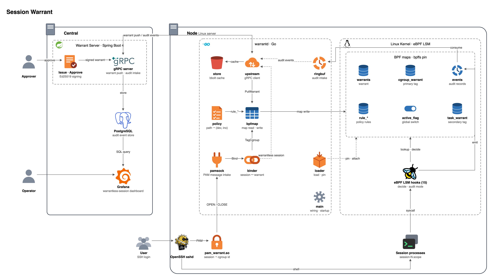

# Session Warrant

**English** | [한국어](README.ko.md)

**Scoped, time-limited SSH access, enforced by the kernel instead of the shell.**

## Contents

- [Overview](#overview)
- [Purpose](#purpose)
- [Technical details](#technical-details)
- [Tech stack](#tech-stack)
- [Requirements](#requirements)
- [Installation](#installation)
- [Documents](#documents)

---

## Overview

Session Warrant attaches a **warrant** to every SSH session: who is logging in,
why, until when, and what they may do. The warrant is enforced by **eBPF LSM
hooks** inside the Linux kernel, so it follows the session through `sudo`,
`su`, `nohup` and background jobs, and it expires while the session is still
open.

Gateway-style SSH access control (Teleport, StrongDM, Boundary, and similar)
controls the door. Session Warrant controls **what happens after the door**.
It complements a gateway rather than replacing it.

### Key properties

- **The kernel enforces it.** LSM hooks decide after the DAC check, so uid 0 cannot step outside the warrant either.
- **The tag follows the session.** It is bound to the session cgroup and to the fork chain, and survives `sudo`, `su` and `nohup`.
- **Expiry takes effect inside an open session.** Every decision compares the clock; no timers. Revocation is one byte.
- **No user-space round trip at decision time.** If the central server or the node agent dies, issued warrants keep being enforced.
- **Warrantless logins are caught.** A login that bypassed the gateway is recorded with person, key and source address, and raises an alert.
- **Adopt in stages: audit → dry-run → enforce.** Audit needs no reboot; enforcement is turned on with the collected data as evidence.
- **Cheap.** Reads are not controlled and one write-bit test filters them, so `file_open` costs under 1% even on a write-saturated workload.

---

## Purpose

Three things a gateway structurally cannot do, done on the host:

| Gateway limit | On the host |
|---|---|
| **Bypassable.** One directly registered `authorized_keys` entry or one emergency path, and the gateway is out of the loop | The host catches every session without a warrant |
| **Blind inside the session.** After the shell is handed over, `scp`, port forwarding and non-interactive commands are outside the protocol layer | `exec`, `connect` and file writes are decided per syscall |
| **Attribution collapses.** Everyone logs in as `ec2-user` and runs `sudo`; the kernel then sees only uid 0 | Every action carries a person's name, including inside containers |

The honest framing: this does not *remove* root. It **attaches a reason and a
deadline to what root does.** It does not contain a kernel exploit or a
compromised boot path. It does stop a person who came in through the normal
path from stepping outside what was approved, and it makes that record hard to
forge.

### What a warrant looks like

```
Session Warrant  W-4821-3F
  Subject     alice@example.com  (login account: ec2-user, key SHA256:jboF…)
  Reason      INC-4821 payment latency incident
  Targets     prod-payment-{03,04}
  Valid       14:00 → 14:30  (30 min, auto-expires)
  Exec        git, less, tail, journalctl, ps, ss
  Write       denied, except /tmp/w-4821
  Outbound    denied
```

`rbash` or `sudoers` can imitate this, but they are bypassed from inside the
session. A warrant is enforced by LSM hooks and cannot be overturned from
inside the session.

### What the user sees

Warrant: write access under `/app` for two hours.

```
[14:03] $ vi /app/config.yml        → saved             under /app's directory inode
[14:05] $ sudo vi /etc/nginx.conf   → :w fails          uid 0 does not help: DAC first, then LSM
[14:12] $ curl https://evil.sh      → connect: EPERM    outbound not in warrant
[14:20] $ nohup ./deploy.sh &       → runs              tag follows the child
[16:00] expiry                      → writes and outbound refused, shell stays open
```

Errors are the ordinary `Permission denied`. At expiry the default is
**downgrade**, not kill: privileges die, the session and its jobs live.
Terminate and grace are per-warrant options.

Each warrant picks a mode. **Audit** only records denials (`WOULD_DENY`),
**dry-run** applies a policy to preview what it would block, and **enforce**
blocks. Audit mode alone answers "how many logins a day arrive without a
warrant" and produces an organization-wide SSH access report — start in audit
without a reboot, then turn on enforcement with the collected data as evidence.

---

## Technical details

Per-flow details (diagram, steps, rationale, code locations) are in
[`docs/flows.md`](docs/flows.md) (Korean).

### Architecture: three planes

The central server issues warrants. `warrantd` on the node copies them into
kernel maps and binds them to SSH sessions. **The kernel decides using only
those maps; there is no user-space round trip at decision time.** If the
central server is unreachable or `warrantd` dies, warrants already in the maps
keep enforcing and expiring.



*Target architecture. Source: [`docs/architecture.en.drawio`](docs/architecture.en.drawio) (open with draw.io).*

```
 CENTRAL (server/)          NODE · USER SPACE                  NODE · KERNEL (bpf/)
 ┌──────────────────┐       ┌──────────────────┐              ┌──────────────────────────┐
 │ issue · approve  │ push  │ warrantd         │  map write   │ BPF maps                 │
 │ identity (OIDC)  │ ────▶ │  verify signature│ ───────────▶ │  cgroup_warrant          │
 │ Ed25519 signing  │ gRPC  │  compile policy  │              │  task_warrant            │
 │                  │       │  bind sessions   │              │  warrants (exp·rev·mode) │
 │ audit store      │ ◀──── │  consume ringbuf │ ◀─────────── │  rule_exec/write/net     │
 │ (PostgreSQL)     │ audit │                  │  ringbuf     │  events                  │
 └──────────────────┘       └──────────────────┘              ├──────────────────────────┤
          │                          ▲ unix socket             │ BPF programs             │
          ▼                 ┌──────────────────┐              │  lsm/bprm_check_security │
 ┌──────────────────┐       │ sshd             │              │  lsm/file_open · inode_* │
 │ Grafana          │       │  pam_warrant.so  │   syscall    │  lsm/socket_connect      │
 │ warrantless ·    │       │  bash·sudo·vim   │ ───────────▶ │  tp/sched_process_fork   │
 │ alerts           │       └──────────────────┘              └──────────────────────────┘
 └──────────────────┘
```

| Component | Language | Role |
|---|---|---|
| Central server (`server/`) | Java / Spring Boot | Approval, identity, warrant signing, audit store, gRPC push to nodes |
| `warrantd` (`agent/`) | Go | Loads BPF, attaches hooks and pins to bpffs. Verifies warrant signatures, compiles policy (paths → `(dev, ino)`, CIDRs → LPM), binds sessions (login account + SSH key fingerprint), consumes the ringbuf, uploads audit |
| `pam_warrant.so` (`pam/`) | C | In sshd's PAM session stack, after `pam_systemd.so`. Resolves `XDG_SESSION_ID` → `session-N.scope` cgroup id and sends it with account, source and `SSH_AUTH_INFO_0` to `warrantd`. Never waits; never blocks a login |
| BPF programs (`bpf/`) | C | LSM hooks for exec, write, egress and self-protection; fork propagation; the shared verdict function |
| Dashboard (`deploy/grafana/`) | Grafana | Reads PostgreSQL directly: warrantless sessions, loss gaps, nodes, webhook alerts |

### The tag: two layers

The product stands or falls on one question: does the tag survive `sudo`,
`su`, `nohup` and backgrounding? It is applied twice.

1. **cgroup.** systemd-logind creates `session-N.scope` for every SSH login.
   The warrant is keyed on that cgroup id. One `bpf_get_current_cgroup_id()`
   resolves it, independent of uid. It is the cgroup id and not the session
   number because `XDG_SESSION_ID` is reused — keyed on it, the next session
   would inherit someone else's warrant.
2. **fork propagation.** `sched_process_fork` copies the parent's tag into the
   child's task storage. Covers processes that leave their cgroup.

| Action from the session | cgroup | fork chain | tag |
|---|---|---|---|
| `nohup` · `setsid` · `&` · `sudo` · `su` | kept | kept | **kept** |
| `systemd-run --scope` | changed | kept | **kept (2nd layer)** |
| `systemd-run` · `systemctl start` · `at` · `cron` · `docker exec` | changed | broken | broken |

The last row is delegation to another daemon, closed by policy: the exec
allowlist refuses those binaries, and `socket_connect` refuses `AF_UNIX`
connections to systemd, D-Bus and `docker.sock`. Full succession over D-Bus
signals is Phase 2.

### Decision path

```
syscall → (after DAC) LSM hook
① active_flag                     ── no warrant on the node ──▶ pass
② cgroup_warrant[my cgroup]
③ miss → task_warrant[me]         ── not managed ─────────────▶ pass
④ warrants[warrant_id]
⑤ revoked · expired               ── expired ─────────────────▶ decide with downgrade rules
⑥ rule_exec · rule_write · rule_net
⑦ audit record → ringbuf          every denial; allows only for exec and connect
⑧ mode == ENFORCE && deny → -EPERM   audit and dry-run only record
```

- **Expiry happens in the kernel.** Each decision compares `bpf_ktime_get_boot_ns()` with `expires_ns`.
  No timer, no process walk. Revocation is one byte (`revoked = 1`).
- **Reads are not controlled.** `file_open` drops reads with a single `f_mode & FMODE_WRITE` test.
  The price is paid by denying outbound by default: you can read, but not send it out.
- **Audit and enforcement share one verdict function.** Modes split only at ⑧. `kprobe/security_*`
  mirrors call the same function again and cross-check the LSM verdict, so "fine in audit, blocked
  in enforcement" cannot happen structurally.

### How a warrant reaches the node

```
central Subscribe stream: every active warrant → ResyncComplete → changes
   ▼
warrantd: Ed25519 signature over the received bytes
        → target host · expiry · revision checks
        → compile policy → rule maps → warrant map → active_flag
   ▼
SSH login → pam_warrant.so → warrantd: warrant matching account + key fingerprint → tag the cgroup
```

- A warrant changes **only when its revision goes up**. Extension and revocation arrive as new revisions.
- A warrant missing from the server's active set is **revoked, not deleted**. Deleting it would leave its
  tagged sessions "unmanaged" instead of cut off.
- If fewer warrants verify than the server listed (usually a key mismatch), the cleanup is skipped, so a
  single misconfiguration cannot revoke every valid warrant.

### Kernel maps

| Map | Type | Key → Value | Role |
|---|---|---|---|
| `active_flag` | `PERCPU_ARRAY` | `0 → u8` | No warrant → every hook passes at once |
| `cgroup_warrant` | `HASH` | `cgroup_id → warrant_id` | Primary binding |
| `task_warrant` | `TASK_STORAGE` | `task → warrant_id` | Secondary binding, copied on fork |
| `warrants` | `HASH` | `warrant_id → struct warrant` | Expiry, subject, policy, revoked, mode, on_expiry |
| `rule_exec` | `HASH` | `(policy, dev, ino) → u8` | Allowed binaries |
| `rule_write` | `HASH` | `(policy, dev, ino) → {effect, recursive}` | Write rules, longest match, deny wins |
| `rule_net` | `LPM_TRIE` | `(policy, CIDR) → {proto, port}` | Allowed outbound |
| `events` | `RINGBUF` | → audit record | A skipped `(cpu, cpu_seq)` surfaces as an explicit loss gap |

```c
struct warrant {            // 32 bytes, generated from proto/warrant.proto
    __u64 expires_ns;       // boot clock; warrantd converts from absolute time
    __u64 grace_ns;
    __u32 subject_id;
    __u32 policy_id;        // prefix of every rule_* key
    __u8  revoked;          // one byte, immediate revocation
    __u8  mode;             // 0 audit · 1 dry-run · 2 enforce
    __u8  on_expiry;        // 0 downgrade · 1 terminate · 2 grace
    __u8  break_glass;      // the only warrant past self-protection
    __u8  inspect_udp;      // also judge UDP sent without connect
};
```

### Self-protection

"A boundary stronger than root" only holds if root cannot switch the boundary
off. Inside a warranted session the product blocks the following. These are
not policy; the product inserts them, so a warrant author cannot open them by
mistake.

Five hooks — `lsm/bpf`, `task_kill`, `sb_umount`, `ptrace_access_check`,
`kernel_module_request` — plus write denial on warrantd's own directories
(`/var/lib/warrantd`, `/run/warrantd`, `/etc/warrantd`).

### Failure behavior

The enforcement path (kernel) **fails hard**. The issuance path (PAM, central)
**fails soft**. The asymmetry is deliberate.

| Situation | Behavior |
|---|---|
| Central server unreachable | Warrants in the maps keep enforcing; only new issuance stops. Audit queues and is resent on reconnect |
| `warrantd` dies | BPF is pinned to bpffs; enforcement, expiry and revocation continue. systemd restarts it after 1 s |
| PAM cannot reach `warrantd` | **Allow the login.** Fail-closed here would lock everyone out during an outage |
| One LSM hook fails to attach | `warrantd` refuses to start. Running with self-protection missing is the worst case |

### Known gaps

All four are recorded in audit mode and committed with skip reasons in
`bench/bypass/known_holes.bats`. Not blocked, but not invisible.

| Gap | Cause | Answer |
|---|---|---|
| Write fd opened before expiry | `file_open` sees only the open | `on_expiry=terminate`, or audit only |
| UDP without `connect` | `sendto` skips `socket_connect` | `lsm/socket_sendmsg`, turned on by the policy's `inspect_udp` |
| Delegation to another daemon | PID 1, atd, containerd-shim fork on the caller's behalf | Exec allowlist + socket block + spool block. D-Bus succession in Phase 2 |
| `kubectl exec` | Born in the container cgroup, no session scope | Bind from the API-server audit webhook to the next `runc exec`. Phase 2 |

### Repository layout

```
proto/    protobuf schema — single source for the kernel struct, server entities and map values
bpf/      C · BPF programs (vmlinux.h is generated, not committed). wtest.sh · vsession.sh harnesses
agent/    Go · warrantd (cmd/warrantd · internal/{loader,bpfmap,pamsock,policy,ringbuf,upstream,store})
pam/      C · pam_warrant.so (kept under 200 lines)
server/   Java · Spring Boot central server
deploy/   bootstrap.sh · enable-bpf-lsm.sh · systemd/ · grafana/
bench/    overhead/ (hook cost) · bypass/ (bypass paths) · pamtiming/ (PAM timing) · inode/ (inode stability)
docs/     planning documents, experiment log, flow document, architecture diagram
```

Each directory's `README.md` states the constraints that layer must respect.

---

## Tech stack

| Layer | Language | Key dependencies |
|---|---|---|
| BPF programs | C | libbpf · vmlinux.h · clang/LLVM 18+ · CO-RE |
| `warrantd` | Go 1.25+ | cilium/ebpf v0.22 · go:embed (BPF object inside the binary) · grpc-go v1.81 · protobuf-go v1.36 · x/sys/unix |
| PAM module | C | libpam |
| Central server | Java 25 (LTS) | Spring Boot 4.1.1 · Web MVC + virtual threads · Security (OIDC) · Data JPA · Flyway · `spring-boot-starter-grpc-server` · Lombok |
| Contract | protobuf | `proto/` — `warrant`, `agent`, `audit`. Java and Go are generated |
| Database | — | PostgreSQL 18, declaratively partitioned audit events |
| Dashboard | — | Grafana 13 on PostgreSQL, provisioned dashboards and alerts |
| Tests | — | Go `testing` + bufconn · JUnit 5 + Testcontainers · bats · shell harnesses (`wtest.sh`, `vsession.sh`) |

- **Four languages is a constraint.** BPF is C only. PAM is `dlopen`ed into sshd, so no Go runtime
  there. The server is Java by decision. Go rather than Rust for the agent because the criterion was
  "when stuck, does a search unblock you", not performance.
- **CO-RE.** The same `warrant.bpf.o` loads on kernel 6.8 and 7.0 unchanged. Nodes need no kernel headers or clang.
- **Signatures cover the protobuf bytes,** not JSON, which brings key-order and whitespace normalization problems. Ed25519 from the JDK.
- Versions are pinned. Follow the checklist in `CLAUDE.md` before bumping them.

---

## Requirements

### Node (where `warrantd` runs)

| Item | Requirement | Check |
|---|---|---|
| Kernel | Linux 5.15+ with BTF and BPF LSM. Reference platforms: Ubuntu 24.04 (6.8), Ubuntu 26.04 (7.0), Rocky 9 | `ls /sys/kernel/btf/vmlinux` |
| LSM list | `bpf` in the `lsm=` boot parameter | `cat /sys/kernel/security/lsm` |
| cgroup | v2 (unified) | `stat -fc %T /sys/fs/cgroup` → `cgroup2fs` |
| Sessions | systemd-logind + `pam_systemd.so` (a `session-N.scope` per SSH login) | `systemctl status systemd-logind` |
| SSH | OpenSSH sshd with PAM (`UsePAM yes`) | |
| Privilege | root (BPF load, bpffs pins, PAM configuration) | |

### Build

| Tool | Version | Used by |
|---|---|---|
| clang / LLVM | 18+ | `bpf/` |
| libbpf-dev · bpftool | distribution packages | `bpf/`, harnesses |
| Go | 1.25+ | `agent/` |
| libpam0g-dev · gcc · make | distribution packages | `pam/` |
| JDK | 25 — **no install needed**, Gradle (foojay) provisions it | `server/` |
| Docker | Compose v2 | local PostgreSQL and Grafana, server tests (Testcontainers) |
| bats | | `bench/bypass` |

`./deploy/bootstrap.sh` checks all of the above as a table, and `--install`
installs what is missing on Ubuntu 22.04 / 24.04.

- **Develop BPF LSM on physical hardware rather than a VM.** It depends on boot parameters and kernel
  BTF, and a virtualization layer makes every failure ambiguous between kernel and hypervisor.
  Editing and compiling in a VM is fine.
- On macOS only `server/` and `agent/internal/{upstream,store,pamsock,pb}` build and test; the rest is Linux-only.

---

## Installation

### 1. Check the environment and enable BPF LSM (node)

```sh
./deploy/bootstrap.sh              # kernel · BTF · lsm=bpf · toolchain
./deploy/bootstrap.sh --install    # install what is missing
sudo ./deploy/enable-bpf-lsm.sh    # append ,bpf to lsm= → reboot
cat /sys/kernel/security/lsm       # bpf must be listed
```

`enable-bpf-lsm.sh` **appends `,bpf` to the currently active list.** Writing
`lsm=bpf` alone drops AppArmor and can break boot.

### 2. Central server and dashboard

```sh
cd server
docker compose -f compose.yaml up -d --wait   # PostgreSQL 18 (host 5433) · Grafana (:3000)
./gradlew bootRun                             # HTTP :8080 · gRPC :9090. Flyway creates the schema
```

Grafana opens at `http://localhost:3000`, read-only without login, on the
"warrantless sessions" dashboard. Alerts go to `GRAFANA_ALERT_WEBHOOK_URL`
(locally the compose `alert-sink`).

### 3. Install warrantd (node)

```sh
make -C bpf warrant.bpf.o
(cd agent && go build -o ../.cache/bin/warrantd ./cmd/warrantd)
sudo deploy/systemd/install.sh -upstream <central-host>:9090
sudo journalctl -u warrantd -o cat            # "N hooks attached, pinned at …" means it is up
```

- `warrantd.service` is `Type=notify` and `Before=ssh.service`: sshd starts only after the PAM socket
  is open, so sessions right after boot are tagged too.
- Maps and links are pinned under `/sys/fs/bpf/warrant`. Restarting `warrantd` keeps the tags and never
  attaches a hook twice. **A new BPF object takes effect after a reboot.**
- Arguments go to `WARRANTD_ARGS` in `/etc/default/warrantd`. Remove with `sudo deploy/systemd/install.sh --uninstall`.

### 4. Give warrants

**From the central server.** Put the central signing public key at
`/etc/warrantd/keys/<key_id>.pem` (Ed25519 PKIX `PUBLIC KEY` PEM — JDK
`PublicKey.getEncoded()` wrapped in PEM). Without a key, `warrantd` does not
subscribe to warrant pushes.

**From a local file, for testing.** Without a central server, write
`proto/warrant.proto` `Warrant` messages as a JSON array to
`/etc/warrantd/warrants.json`. Example:
[`deploy/systemd/warrants.example.json`](deploy/systemd/warrants.example.json).
It is read once at startup; run `sudo systemctl restart warrantd` after
editing. It carries no signature, so it is for testing only.

A session receives a warrant only if **both the login account and the SSH key
fingerprint** match. Same account with a different key is recorded as
`KEY_MISMATCH`.

### 5. Hook into sshd's PAM stack

> ⚠ A mistake in `/etc/pam.d/sshd` can lock you out of SSH. **Secure console access or a revert path first.**

```sh
# a timer that reverts by itself after 10 minutes
sudo systemd-run --unit=pam-deadman --on-active=10min /usr/bin/make -C $PWD/pam disable
sudo I_CAN_RECOVER=1 make -C pam enable-sshd TEST_SOCK=/run/warrantd/pam.sock
# open a new SSH login from another terminal; if it works, cancel the timer
sudo systemctl stop pam-deadman.timer
```

`pam_warrant.so` goes after `pam_systemd.so`. Remove it with `sudo make -C pam disable`.

### 6. Verify

```sh
sudo make -C pam test-detached TEST_SOCK=/run/warrantd/pam.sock   # simulate one warrantless session without PAM
```

When `binder: unwarranted session …` appears in the `warrantd` log and one row
shows up on the Grafana "warrantless sessions" dashboard, the path works end
to end.

### Tests

```sh
cd server && ./gradlew test                    # needs Docker (Testcontainers)
cd agent && go test -race ./...                # Linux. On macOS: GOOS=linux go vet ./...
make -C bpf test                               # kernel verdict harness (needs BPF LSM, uses sudo inside)
sudo bpf/vsession.sh                           # three modes cross-checked in a real session-N.scope
cd bench/bypass && make && sudo make test      # bypass-path table (bats)
```

---

## Documents

Planning documents are in Korean.

| Document | Contents |
|---|---|
| [`docs/session-warrant-plan.html`](docs/session-warrant-plan.html) | Concept, plan and architecture (§01–§19) |
| [`docs/session-warrant-tech-stack.html`](docs/session-warrant-tech-stack.html) | Technology choices and rationale |
| [`docs/session-warrant-ebpf-fields.html`](docs/session-warrant-ebpf-fields.html) | Every value the BPF programs extract |
| [`docs/flows.md`](docs/flows.md) | The eleven core flows — startup, warrant install, session binding, kernel verdict, audit upload, … |
| [`docs/experiments.md`](docs/experiments.md) | Validation experiments — overhead, tag propagation, PAM timing |
| [`deploy/README.md`](deploy/README.md) | Operations: systemd unit, warrant file, central keys, Grafana |
| [`docs/architecture.en.drawio`](docs/architecture.en.drawio) | Architecture diagram source ([한국어](docs/architecture.drawio)) |
